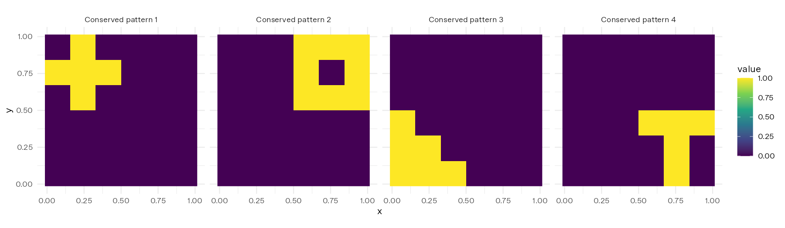
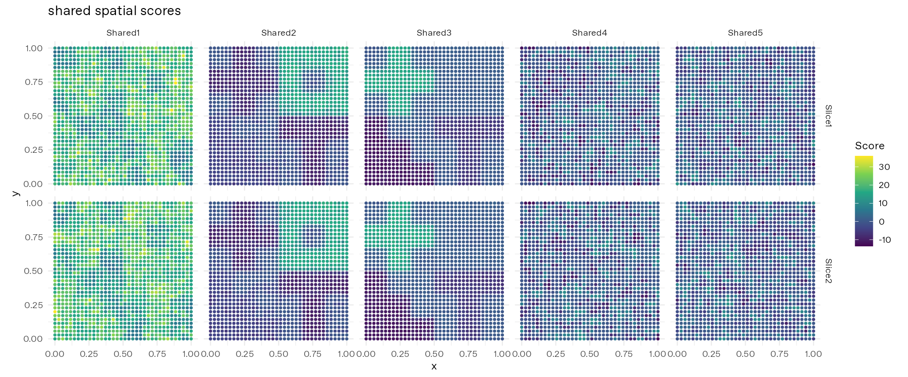
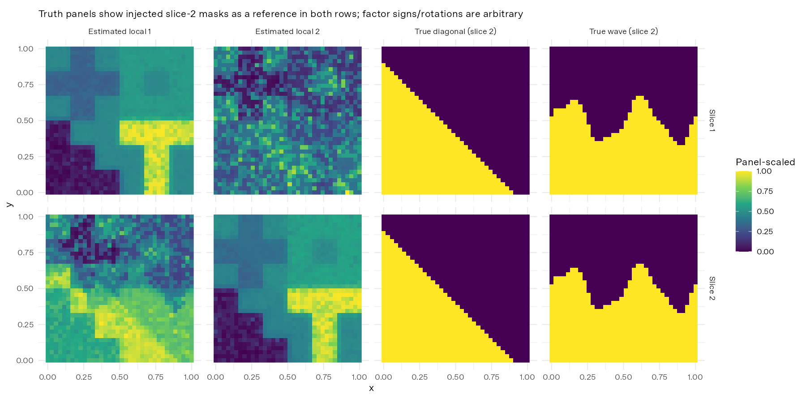
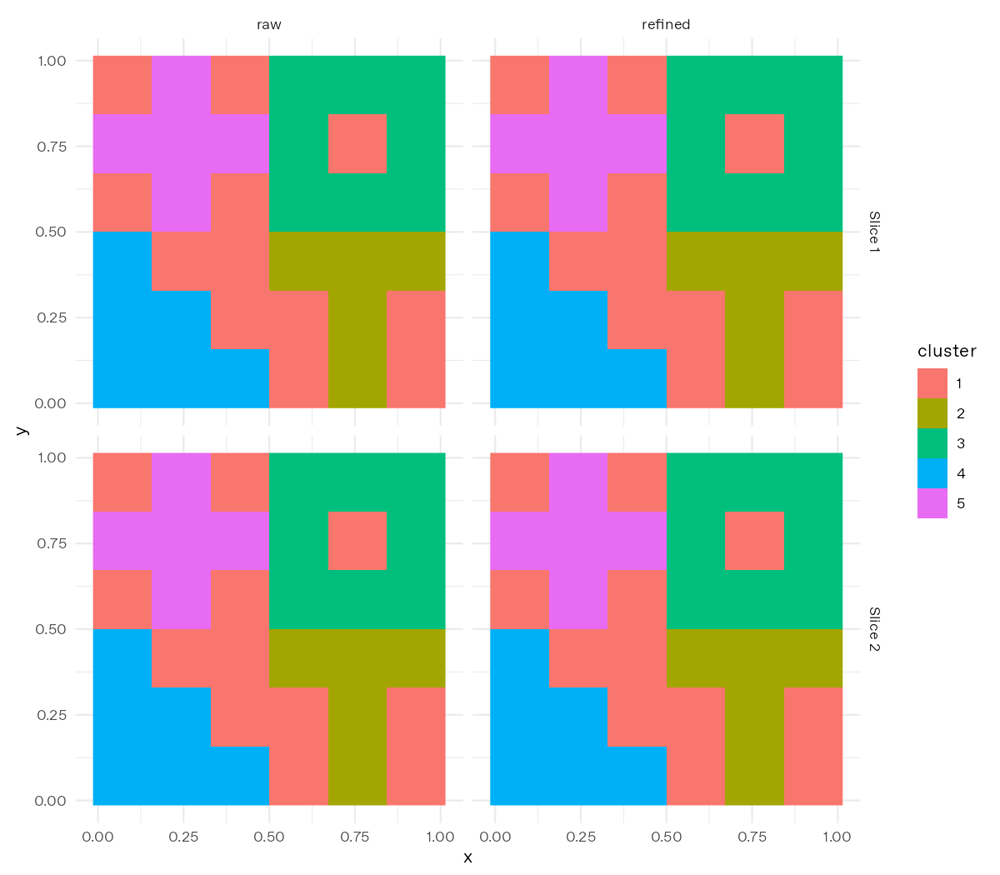

# MSGPCA

**Multi-Slice Graph Principal Component Analysis · version 0.1.0**

MSGPCA jointly analyzes spatial omics slices while distinguishing conserved
molecular programs from slice-specific spatial heterogeneity. It supports
spatial transcriptomics and spatial proteomics, including slices with different
numbers of observations and no cross-slice spatial alignment.

## Method

For each preprocessed observations-by-features matrix,

\[
Y_m\approx F_{s,m}W_s^\top+F_{\ell,m}W_{\ell,m}^\top.
\]

Shared loadings \(W_s\) define common molecular metafeatures; shared scores
\(F_{s,m}\) map their activity in each slice. Local loadings and scores describe
slice-specific programs. Loading columns are orthonormal within components and
\(W_s^\top W_{\ell,m}=0\). Individual factors and the allocation of structure
are not guaranteed unique: signs, rotations and degenerate eigenspaces remain.
There is no additional orthogonality constraint on spatial scores.

Graph Laplacian penalties smooth shared and local scores separately, using
sparse Cholesky solves. Automatic tuning balances reconstruction loss against
**unweighted** spatial roughness through normalized Pareto ideal-point selection.
The original shared-loading update is preserved; the full iteration is not
claimed to guarantee monotonic objective descent. Objective increases are reported.

## Installation

Install dependencies from CRAN and the delivered source archive locally:

```r
install.packages(c("Matrix", "dbscan", "irlba", "mclust", "ggplot2"))
install.packages("MSGPCA_0.1.0.tar.gz", repos = NULL, type = "source")
```

The package itself contains no compiled code. Development/testing additionally
uses testthat and roxygen2; building the HTML vignettes uses knitr, rmarkdown and
Pandoc. A repository URL has not been supplied, so no GitHub installation address
is assumed. See the development report for the executed installation/check record.

## Input format and preprocessing

- One numeric matrix per slice; rows are spatial observations and columns are
  common molecular features in **identical identity and order**.
- One coordinate matrix per slice, with corresponding observation rows. Feature,
  observation and slice identifiers are preserved and checked where available.
- Unequal slice sizes and different coordinate systems are supported. No alignment
  or cross-slice graph edges are required.
- Preprocess abundances before fitting. The package does not normalize, log,
  center or scale. Choose transformations appropriate to the measurement assay.
- Ordinary and sparse matrices are supported. Feature covariances, residuals and
  SVD initialization can densify; this release uses dense feature-space solvers.
- Coordinates can be omitted when all required graphs are supplied or active
  smoothing is zero. Spatial plots and refinement still require coordinates.

Supplied graph entries default to combinatorial Laplacians. Use
`list(type="adjacency", matrix=A)` for adjacency entries. Graphs must be symmetric;
adjacency weights nonnegative; disconnected components and isolated vertices are
valid. Mutual k-NN is default; `graph_type="union"` is available.

## Quick start

This complete example uses a smaller grid for quick execution. Omit `nside=12`
to use the original 36 by 36 simulation. Defaults generate 400 genes; the supplied
manuscript reports 500 without a matching source composition.

```{r quickstart}
library(MSGPCA)
sim <- simulation_gg_blocks(n_slices=2, nside=12, scenario="wave", seed=101)
Y_list <- lapply(sim$Y_list, log1p)
fit <- MSGPCA(
  Y_list, sim$locs_list,
  n_shared=5, n_local=2, k_shared=4, k_local=6,
  lambda_shared=0.3, lambda_local=0.1, seed=101, verbose=FALSE
)
summary(fit)
plot_convergence(fit)
plot_factors(fit, component="shared")
plot_factors(fit, component="local")
```

`n_shared`/`n_local` are factor dimensions; `k_shared`/`k_local` are neighbor
counts. Zero factor dimension disables a component; zero smoothing retains its
factors. At least one component must be active. Initialization is iteration zero;
`iterations` counts completed updates. Inspect `converged`, `termination_reason`,
`diagnostics`, `relative_change` and `objective_increases` before interpretation.
A small relative objective change is a stopping diagnostic, not a global-optimum
certificate.

## Pareto tuning

```{r tuning}
fit_tuned <- MSGPCA(
  Y_list, sim$locs_list, n_shared=5, n_local=2,
  lambda_shared=c(0.1,0.3,0.6), lambda_local=c(0.1,0.3),
  tuning="pareto", seed=101, verbose=FALSE
)
plot_pareto(fit_tuned)
fit_tuned$optimal_lambda_shared
fit_tuned$optimal_lambda_local
fit_tuned$pareto_results
```

The full study grid is `seq(0.1,0.6,0.1)` for each parameter. The standalone
`tune_MSGPCA()` has the same fitting controls and an optional
`lambda_constraint="shared_ge_local"`. No restriction is imposed by default.

Both reconstruction loss and unweighted roughness are min-max normalized over
eligible candidates. The minimum Euclidean distance to (0,0) selects the fit.
Nondominated candidates are flagged explicitly. Exact ties use input grid order;
constant ranges map to zero. Results depend on the candidate grid. Failed and
nonfinite fits are excluded; converged fits have priority. If none converged,
the default warns and selects among finite nonconverged candidates. Use
`nonconverged="exclude"` in `tune_MSGPCA()` to disallow that fallback.
Truth labels and clustering metrics never enter selection.

## GMM and K-means spatial domains

```{r clustering}
cl_gmm <- cluster_MSGPCA(fit, n_clusters=5, method="gmm",
                        refine=TRUE, refine_shape="square", seed=101)
cl_kmeans <- cluster_MSGPCA(fit, n_clusters=5, method="kmeans",
                           refine=TRUE, refine_shape="square", seed=101)
plot_clusters(cl_gmm)
plot_clusters(cl_kmeans)
plot_clusters(cl_gmm, refined=FALSE)
raw_labels <- cl_gmm$raw[[1]]
coordinates <- sim$locs_list[[1]]
refined_labels <- refine_cluster(raw_labels, coordinates, shape="square")
stopifnot(identical(refined_labels, cl_gmm$refined[[1]]))
```

GMM with refinement is default; mclust selects its covariance model, retained in
`cl_gmm$gmm_model`. K-means defaults to 25 starts. Shared scores are pooled then
split into slices; local scores are clustered separately. Set `component="local"`
for local clustering and `factors=` for a scientifically justified fixed subset.
No implicit score standardization is applied. Local factors and local cluster
identifiers are not automatically aligned across slices.

Set `refine=FALSE` for raw assignments only; `$refined` is then NULL. Otherwise,
both raw and refined labels, reassignment counts/proportions and separate runtimes
are retained. Both methods refine the same raw labels independently by slice.

Refinement is adapted from SpatialPCA. It includes the focal observation plus
four (`square`) or six (`hexagon`) nearest neighbors and makes one sequential
pass using the original strict frequency thresholds. Conventional 10x Visium
layouts use `shape="hexagon"`; ggblocks uses `"square"`. Shape selects neighborhood
size, not tissue geometry. Tied distances follow input order. Duplicate
coordinates and too-small slices are errors. Output labels are character,
preserving label identities. The default bounded-memory k-NN/radius-query implementation retrieves all
boundary-distance ties before sorting by exact distance and row order. Use
`engine="reference"` for rowwise distances. Worst-case distance work remains
quadratic; no universal subquadratic speedup is claimed.

## Denoising and metafeatures

```{r denoising}
Y_denoised <- reconstruct_MSGPCA(fit, component="all")
Y_shared <- reconstruct_MSGPCA(fit, component="shared")
Y_local <- reconstruct_MSGPCA(fit, component="local")
selected <- reconstruct_MSGPCA(fit, slices=1, features=c("Gene1","Gene360"))
stopifnot(isTRUE(all.equal(Y_denoised[[1]], Y_shared[[1]]+Y_local[[1]])))
shared_scores <- get_scores(fit, component="shared")
local_scores <- get_scores(fit, component="local")
shared_loadings <- get_loadings(fit, component="shared")
local_loadings <- get_loadings(fit, component="local")
head(sort(shared_loadings[,1], decreasing=TRUE))
head(sort(shared_loadings[,1], decreasing=FALSE))
head(sort(abs(shared_loadings[,1]), decreasing=TRUE))
plot_loadings(fit, component="shared", top=10)
```

Loading columns define metafeatures and score columns show their spatial
activity. Large loadings indicate contribution, not statistical significance.
Signs and rotations may differ across equivalent fits. Reconstructions remain
on the supplied preprocessed scale; no inverse transformation or count
interpretation is applied. Select slices/features to avoid allocating complete
reconstructed expression matrices. No unobserved-location prediction is offered.

## Computed illustrations

The following are generated by the package on the ggblocks simulation, seed 101.






## Citation, authors and license

Anirban Chakraborty, Brian Neelon, Andrew Lawson, Peggi Angel, Dongjun Chung and
Souvik Seal. *MSGPCA: Multi-Slice Graph PCA for replicate-aware Spatial Omics
analysis*. Supplied manuscript; publication status, date, journal and DOI are not
specified. See `citation("MSGPCA")`. Software maintainer: Anirban Chakraborty
(`anirban0451@gmail.com`).

The refinement function is adapted from:

Shang, L. and Zhou, X. (2022). Spatially aware dimension reduction for spatial
transcriptomics. *Nature Communications* **13**, 7203.
https://doi.org/10.1038/s41467-022-34879-1

Upstream source: SpatialPCA `R/SpatialPCA_utilties.R`, commit
`1d4dbb1fe6f23b77bb7ed805ce2de8bbc017ef66`.
[Source and modifications](inst/UPSTREAM.md). Upstream notices are preserved in
`inst/upstream/`. MSGPCA is distributed under **GPL (>=3)**; GPL-3 text is in
[inst/COPYING](inst/COPYING). No public repository publication is performed by
this delivery.
